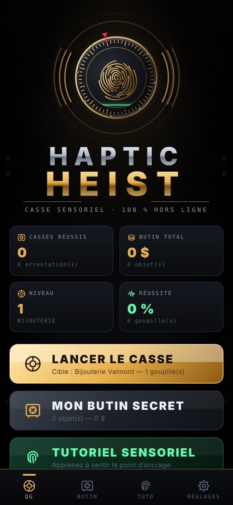
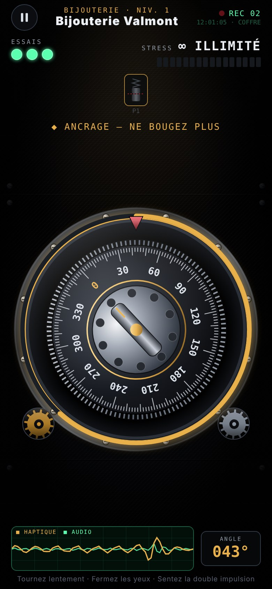
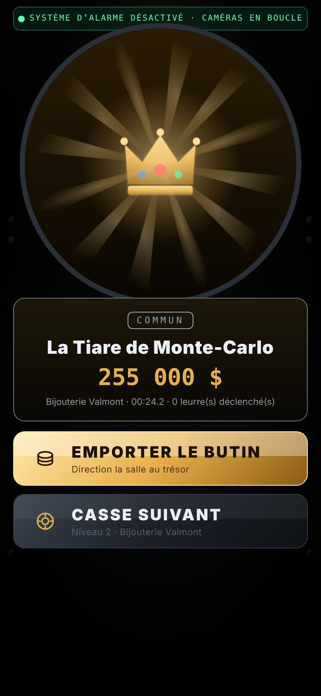
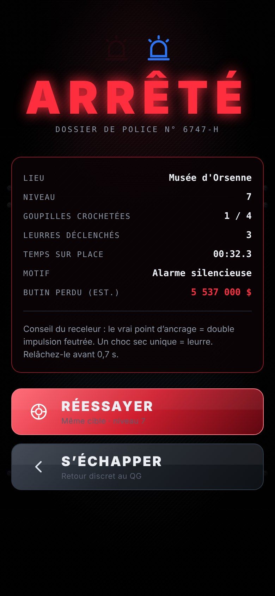

# Haptic Heist

A safe-cracking game you play by feel: you find the lock's anchor points through the phone's vibrations alone. It runs fully offline, with no account, no ads and no purchases. All data is stored on the device with AsyncStorage.

The whole game is in **`App.tsx`**: every visual is drawn in SVG and animated with `Animated`, and every sound is synthesized in code.

## Running it in Expo Go

```bash
npm install
npx expo start
```

Then scan the QR code with **Expo Go (SDK 57)**.

## Packages (all bundled in Expo Go)

- `expo-haptics`: the micro-ticks, the progressive tremor, the anchor's double pulse, the decoy's single hard knock, and the alarm.
- `expo-audio`: plays the sounds, which are generated as PCM and written as WAV files to the local cache with `expo-file-system`. `expo-av` was removed from Expo Go after SDK 54.
- `expo-linear-gradient`, `react-native-svg`, `react-native-safe-area-context`.
- `@react-native-async-storage/async-storage`: saves are written twice (main and backup), validated against a schema on load, and fall back to in-memory storage if needed.

## Testing without real hardware

In **Settings**:

- **Visual haptic simulator**: flashes the screen border on every vibration.
- **Cheat mode**: shows the targets and decoys on the dial and the Δ to the nearest one, widens the tolerance, and lets you pick the level in the briefing.

## Mockup

Screenshots of the real game, rendered for the web at 390×844 (`npx expo start --web`): [`docs/maquette/`](docs/maquette/).

| Main menu | Heist | Loot reveal | Busted |
|---|---|---|---|
|  |  |  |  |
