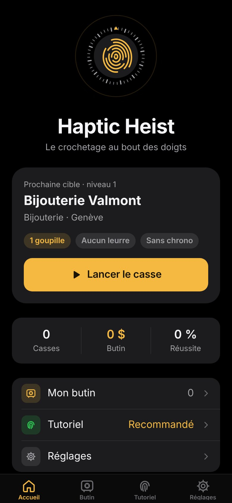
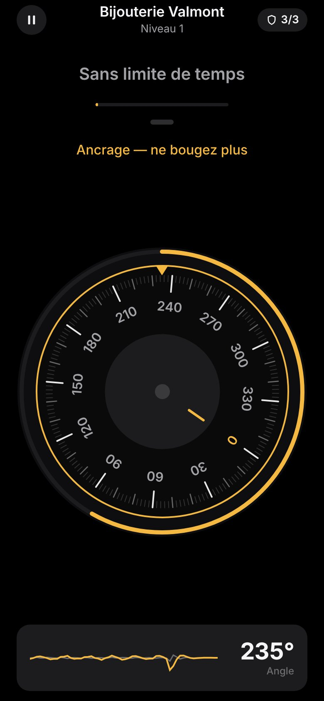
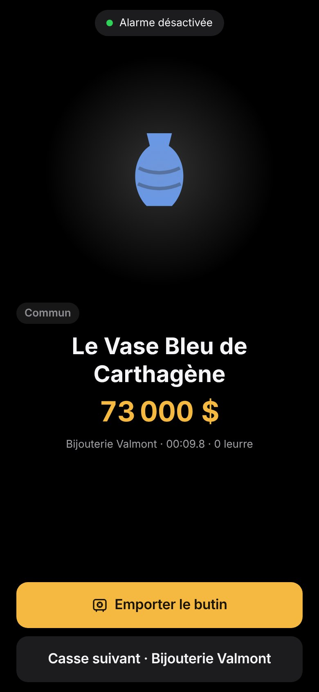
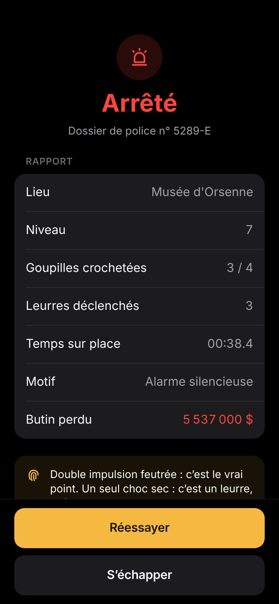

# Haptic Heist

A safe-cracking game you play by feel: you find the lock's anchor points through the phone's vibrations alone. It runs fully offline, with no account, no ads and no purchases. All data is stored on the device.

## Running it

```bash
npm install
npx expo start         # scan the QR code with Expo Go (SDK 57)
npx expo start --web   # visual preview in a browser (no vibrations)
```

## Architecture

```
app/                      File-based navigation (expo-router)
  _layout.tsx             Providers, root stack, sound ambience
  (tabs)/                 Home · Loot · Tutorial · Settings
  briefing.tsx            Mission file (modal)
  heist.tsx               The heist (full screen, no back gesture)
  success.tsx             Vault opening and loot reveal
  busted.tsx              Arrest
src/
  screens/                One component per screen
  components/
    ui/                   Button, List (Group/Row), Toggle, Segmented, Chip, Layout, Icon
    brand/                Animated logo, app icon
    heist/                Lock dial, HUD (pins, lives, timer, waveform), vault door
    loot/                 Loot pictograms
    system/               ErrorBoundary
  engine/
    haptics.ts            Haptic vocabulary (tick, tremor, anchor, decoy, alarm…)
    audio/synth.ts        Procedural sound synthesis (PCM → WAV)
    audio/SoundEngine.ts  Player pools and loops (expo-audio)
    lock/                 Lockpicking engine (circular gesture, zones, hold)
    pulseBus.ts           Signal bus feeding the waveform and the simulator
  game/content.ts         Locations, difficulty curve, procedural loot
  state/GameProvider.tsx  Global state: career, heist session, actions
  storage/career.ts       Robust persistence (AsyncStorage + backup + validation)
  theme/                  Colors, type scale, spacing, rarities
  types/ utils/ hooks/
```

## Design

- OLED black with layered grey surfaces.
- A single accent color, gold, plus the iOS system colors for success, alert and info.
- The system font, sized on the iOS dynamic type scale.
- No gradients, reflections or material textures.

## Testing without real hardware

In **Settings**:

- **Haptic simulator**: flashes the screen border on every vibration.
- **Cheat mode**: shows the targets and decoys on the dial, widens the tolerance, and lets you pick the level in the briefing.

## Mockup

Screenshots captured from a real playthrough in `docs/maquette/`.

| Home | Heist | Loot reveal | Busted |
|---|---|---|---|
|  |  |  |  |
